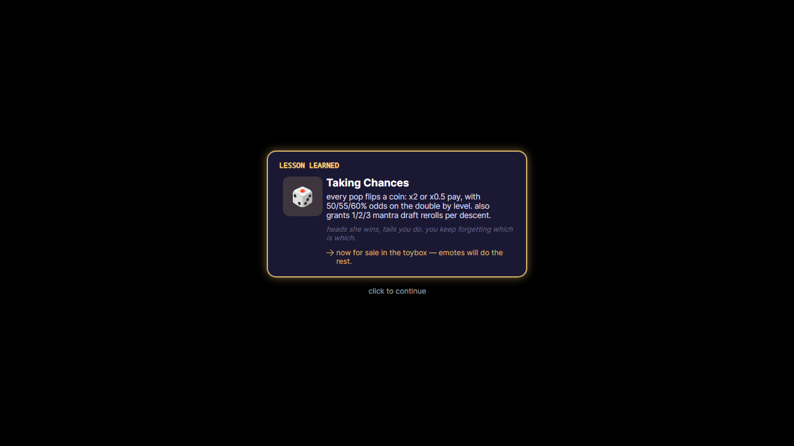

# Chaos lesson unlock overlay

- Adds a queued, clickable mid-run scrim using the existing `ChaosUnlockCardLayer` visual. It uses WPF's 160 ms entrance, 150 ms exit and 12 s timeout for cards that do not own a pause; queued cards swap without fading the scrim. The window spans the screen bounds and centers its card on the primary working area, with `ShowActivated=false` and the existing pin-on-top preference.
- `ChaosRunHost` subscribes to Core `ChaosLessons.LessonCompleted`. The current run owns lesson pauses separately from manual pauses: clock, spawns, bubbles, input and toy use wait until the last card leaves. Manual-pause cards retain the manual pause and may time out. Panic, stop, close and late posted completions cannot leave or revive an unlock overlay.
- Adds the existing WPF prism and subliminal-treat lesson ticks as real gameplay callers. All lesson thresholds, persistence and card decisions remain in the existing Core engines. No WPF source changes and no second lesson engine.
- Uses the shipped app builder for the existing Chaos run/layer tests too, so their headless initialization includes the same cross-platform font mappings as production (no assertion changes).
- Adds headless queue, pointer-click, timeout, pause ownership, real gameplay caller and teardown tests, plus a parameterless sample for `--render-view ChaosUnlockCardOverlay`.
- Source is the WPF reference on `origin/avalonia-port/goongame-core-d`. `parity/trunk` was fetched at `a4ee52d40cd347d288dcf7fdaa8445b79f8e5038`; no trunk code was imported.

## Remaining work: chaos-unlock-card-c

The ledger remains **stub**. This base has no run-host draft transition, ready/GO ownership or freeze-power-up clock. Adding those systems would exceed this unit. When that host lands, defer cards while the draft owns the field, transfer its pause after GO, deliver the deferred welcome shower/final-loop beat only after the last card, and preserve any remaining freeze-power-up hold. Other `ChaosLessonHooks` gameplay sources (rolling treat windows, spatial/cursor hooks, draft and run-end judgments) remain in their respective gameplay lanes. Real item art is also still absent: the existing glyph tile is retained.

## Verification limits

Tests use the repository's isolated `CCP_USERDATA_DIR` profile and headless platform. No real desktop or user profile is used. Native Windows behavior and live multi-monitor placement cannot be run in this Linux cloud environment.

- Fail-before proof: with the original host and the new test, `A_completed_lesson_holds_the_clock_spawns_and_bubble_input` failed with elapsed **expected 0, actual 0.25**. Initial attempts used bare headless setup and stopped at missing Consolas/Segoe font mapping; the recorded behavior proof uses the shipped builder.
- `dotnet test Tests/CCP.Core.Tests/CCP.Core.Tests.csproj -c Release -m:1`: **3102 passed, 5 skipped, 1 failed**. The unchanged `DtrhRemoteMediaTests.Take_ColdCacheFetches_LoopsDryBacksOff_CopiesBecomeAssetUrls` fails at line 185, expected `Loops`, actual `Clips`; rerunning that class reproduces it. The five existing Vosk tests skip without their speech model. No test was weakened or removed.
- `dotnet test Tests/CCP.Core.Tests/CCP.Core.Tests.csproj -c Release --no-build --filter FullyQualifiedName~ChaosUnlockCardRulesTests`: **3 passed**.
- `dotnet test Tests/CCP.Avalonia.Tests/CCP.Avalonia.Tests.csproj -c Release -m:1 --filter 'FullyQualifiedName~ChaosUnlockCardOverlayTests|FullyQualifiedName~ChaosUnlockCardLayerTests|FullyQualifiedName~ChaosRunHostTests'`: **20 passed, 0 failed, 0 skipped** (2 m 17 s), with `DiffEngine_Disabled=true`.
- `bash .github/scripts/core-guards.sh`: passed both guards.
- `CCP_USERDATA_DIR=/workspace/ccp-worker-2-testlogs/render-profile dotnet run --project CCP.Avalonia/CCP.Avalonia.csproj -c Release --no-build -- --render-view ChaosUnlockCardOverlay /workspace/ccp-worker-2-testlogs/ChaosUnlockCardOverlay.png`: passed, 1280×720, no binding errors reported; image visually inspected and included below. This is an offscreen sample, not a live desktop capture.

## Build commands

Ran `dotnet build <project> -c Release -m:1 -p:CreateHardLinksForCopyLocalIfPossible=true -p:CreateHardLinksForAdditionalFilesIfPossible=true` for each Linux project below. Hard links avoid exhausting this shared worker's disk on repeated compile-only outputs; those isolated `bin` directories were removed after each build. The initial normal-copy CatalogueStartup/Consent attempts ran out of disk; both retries passed. Main runtime test outputs used normal copies.

| Project | Result |
| --- | --- |
| `CCP.Core/CCP.Core.csproj` | Build succeeded; 0 errors. |
| `CCP.Avalonia/CCP.Avalonia.csproj` | Build succeeded; 0 errors. |
| `Tests/CCP.Avalonia.CatalogueStartup.Tests/CCP.Avalonia.CatalogueStartup.Tests.csproj` | Build succeeded; 0 errors. |
| `Tests/CCP.Avalonia.Consent.Tests/CCP.Avalonia.Consent.Tests.csproj` | Build succeeded; 0 errors. |
| `Tests/CCP.Avalonia.GeneralSettings.Tests/CCP.Avalonia.GeneralSettings.Tests.csproj` | Build succeeded; 0 errors. |
| `Tests/CCP.Avalonia.Language.Tests/CCP.Avalonia.Language.Tests.csproj` | Build succeeded; 0 errors. |
| `Tests/CCP.Avalonia.Report.Tests/CCP.Avalonia.Report.Tests.csproj` | Build succeeded; 0 errors. |
| `Tests/CCP.Avalonia.Scheduler.Tests/CCP.Avalonia.Scheduler.Tests.csproj` | Build succeeded; 0 errors. |
| `Tests/CCP.Avalonia.Snapshot.Tests/CCP.Avalonia.Snapshot.Tests.csproj` | Build succeeded; 0 errors. |
| `Tests/CCP.Avalonia.Tests/CCP.Avalonia.Tests.csproj` | Build succeeded; 0 errors. |
| `Tests/CCP.Core.Content.Tests/CCP.Core.Content.Tests.csproj` | Build succeeded; 0 errors. |
| `Tests/CCP.Core.Settings.Tests/CCP.Core.Settings.Tests.csproj` | Build succeeded; 0 errors. |
| `Tests/CCP.Core.Tests/CCP.Core.Tests.csproj` | Build succeeded; 0 errors. |
| `Tests/ConditioningControlPanel.Tests/ConditioningControlPanel.Tests.csproj` | Cross-build succeeded; 0 errors. Windows code compiled, not run. |

The isolated test projects above were built, not all executed. Runtime coverage is exactly the filtered Avalonia and Core commands listed above.

The WPF test cross-build used the same command with `-p:EnableWindowsTargeting=true -p:ValidateExecutableReferencesMatchSelfContained=false`. It compiled both the frozen WPF app and its tests; their Windows runtime cannot execute here.
